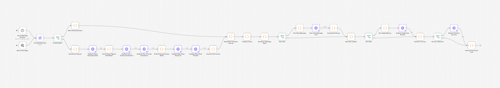

<div align="center">

# n8n-hubspot-onboarding-milestone-stalled-task-alerter

**Client onboarding watchdog that monitors implementation tasks in HubSpot custom objects, flagging overdue deliverables and notifying project managers.**

A dhRobin Systems Revenue Infrastructure blueprint

    

</div>

---

## Table of Contents

1. [Overview](#1-overview)
2. [Architecture and Data Flow](#2-architecture-and-data-flow)
3. [Repository Contents](#3-repository-contents)
4. [Prerequisites](#4-prerequisites)
5. [5-Minute Sandbox Quick Start](#5-5-minute-sandbox-quick-start)
6. [Step-by-Step Import and Configuration Guide](#6-step-by-step-import-and-configuration-guide)
7. [Environment Variables](#7-environment-variables)
8. [Node-by-Node Configuration Guide](#8-node-by-node-configuration-guide)
9. [Stalled Task Scoring Model, Delay Logic and False-Positive Protections](#9-stalled-task-scoring-model-delay-logic-and-false-positive-protections)
10. [Safety Matrix](#10-safety-matrix)
11. [Data Protection and Compliance Checklist](#11-data-protection-and-compliance-checklist)
12. [Operations and Troubleshooting](#12-operations-and-troubleshooting)
13. [Disclaimer and License](#13-disclaimer-and-license)

---

## 1. Overview

Onboarding rarely fails in one dramatic moment. It slips one task at a time: SSO configuration that's four days late, a data migration nobody has touched in a week, a billing contact the client never confirmed. Each slip is visible in HubSpot, but only if someone runs the right view every morning.

I built this watchdog to run that view for you. Every hour on weekdays, it searches your onboarding task custom object for incomplete tasks that are past due (after a grace period) or in progress with no recent update. It works out how late each one is, grades it, and sends each project manager one Slack digest of their stalled tasks, grouped by client. Critical-path delays can also go to a separate escalation channel. It can stamp the task record in HubSpot, and it never repeats an alert for the same task within the cooldown window.

**Outputs per task**

| Field | Meaning |
|---|---|
| `delay_hours` / `days_overdue` | Hours / days past *due date + grace period* (0 when not overdue) |
| `severity_tier` | `critical`, `high`, `moderate`, `low`, `on_track` |
| `is_stalled` | Overdue past grace, or in progress without an update for `STALE_UPDATE_DAYS` |
| `should_alert` | Stalled and tier ≥ `ALERT_MIN_TIER` (before the cooldown) |
| PM routing context | PM name and Slack mention from `PM_ROUTING` (by owner, then client tier, then default), client, milestone, critical path, record link |

**Design principles**

| Principle | Implementation |
|---|---|
| Safe by default | With no environment variables set, the workflow makes **zero HubSpot calls, zero Slack calls and zero writes**. Alerts need `SEND_SLACK_ALERTS=true`, record updates need `WRITE_TO_HUBSPOT=true`, and both also need `SANDBOX_MODE=false` and `DRY_RUN=false`. |
| Schema-agnostic | The custom object type and every property name come from environment variables. Nothing assumes a fixed onboarding schema. |
| Fair to the team | A grace period, client-blocked statuses capped at moderate, completed and test records skipped, and optional weekend exclusion. |
| One message per PM | Digest mode groups each PM's stalled tasks by client, worst first. |
| No alert spam | A per-task cooldown via the record property and workflow memory. Only a higher tier breaks through. |
| Secrets out of data | The HubSpot token and Slack URLs appear only as `{{ $env.* }}` in HTTP header and URL fields. No Code node reads a secret. |

---

## 2. Architecture and Data Flow

```mermaid
flowchart LR
    SCH[Hourly Watchdog Schedule<br/>:05, Mon–Fri UTC] --> CFG
    MAN[Manual Test Trigger] --> CFG[Config & Safety Gate]
    CFG --> SB{Sandbox Mode?}
    SB -- yes --> MOCK[Mock Onboarding Tasks<br/>sample-payloads/hubspot-onboarding-tasks.json]
    SB -- no --> BSR[Build Search Request<br/>overdue past grace OR stale in progress] --> HS[HubSpot: Search Onboarding Tasks<br/>paginated] --> CSP[Collect Search Pages & Build Reads]
    CSP --> AC[Task → Company] --> AP[Task → Contact] --> BR[Build Company & Contact Reads] --> RC[Batch Read Companies] --> RP[Batch Read Contacts] --> ASM[Assemble Task Context]
    MOCK --> AN
    ASM --> AN[Stalled Task Analysis & Scoring<br/>filters · delay · tier · routing]
    AN --> CG[Cooldown Guard] --> SLB[Build Slack Watchdog Alerts<br/>PM digest / per task + critical channel]
    SLB --> SG{Slack Gate}
    SG -- yes --> EM[Emit Slack Messages] --> SP[Slack: Post Watchdog Alert] --> CSR[Collect Slack Results] --> UP
    SG -- no --> UP[Build Task Updates]
    UP --> WG{Write Gate}
    WG -- yes --> EU[Emit Update Batches] --> HU[HubSpot: Update Task Records] --> SUM
    WG -- no --> SUM[Build Run Summary]
    SUM --> SW{Summary Webhook?}
    SW -- yes --> WS[Webhook: Post Run Summary] --> AUD
    SW -- no --> AUD[Execution Summary & Audit]
```





### Stage contracts

| Stage | Output shape |
|---|---|
| Mock Onboarding Tasks / Assemble Task Context | `{ source, objectType, tasks: [{ id, properties, company{ name, domain, tier }, contact{ name, email } }], readErrors[] }` |
| Stalled Task Analysis & Scoring | `{ counts, results: [{ taskId, taskName, milestone, criticalPath, dueDate, evaluated, skipReason, delay_hours, days_overdue, hours_until_due, days_since_update, severity_tier, reason, is_stalled, waiting_on_client, should_alert, pm, recordUrl }] }` |
| Cooldown Guard | Same, plus `alerts[]` and `suppressed[{ taskId, reason }]` |
| Build Slack Watchdog Alerts | Same, plus `messages[{ channel, key, taskIds, body }]` and `slackAllowed` |
| Build Task Updates | `{ updates[{ id, properties }], batches[], writeAllowed }` |
| Execution Summary & Audit | Outcome, safety flags, thresholds, per-task tier, delay and reason, suppressions, Slack and HubSpot results (no contact data) |

---

## 3. Repository Contents

```
n8n-hubspot-onboarding-milestone-stalled-task-alerter/
├── README.md                              Technical documentation (this file)
├── workflow.json                          Importable n8n workflow with sticky notes and pinned synthetic payloads
├── DISCLAIMER.md                          Liability limitation and usage terms
├── LICENSE                                MIT License
└── sample-payloads/
    └── hubspot-onboarding-tasks.json      15 synthetic onboarding tasks + companies + contacts (also embedded in the sandbox node)
```

The object type `2-345001`, all record IDs, companies, people and emails are fictitious. Dates in the fixture are relative offsets, resolved when the workflow runs.

---

## 4. Prerequisites

| Requirement | Detail |
|---|---|
| n8n | Self-hosted **1.60 or later** (Schedule Trigger 1.2, Set 3.4, IF 2, Code 2, HTTP Request 4.2 with pagination, `$('Node').isExecuted`, `v1` execution order). |
| Env access | `N8N_BLOCK_ENV_ACCESS_IN_NODE=false`, so `{{ $env.* }}` expressions resolve. |
| HubSpot private app scopes | **`crm.objects.custom.read`**, **`crm.objects.custom.write`** (only when `WRITE_TO_HUBSPOT=true`), **`crm.schemas.custom.read`** (to look up the object type ID and property names during setup), **`crm.objects.companies.read`**, **`crm.objects.contacts.read`**. |
| Onboarding custom object | One record per task, associated with the client company (and optionally a client contact). Properties, with default internal names: `task_name`, `milestone`, `task_status`, `due_date` (date or date-time), `is_critical_path` (checkbox), `hubspot_owner_id`, `is_test_record` (checkbox), and for write-back `onboarding_status`, `last_alert_timestamp`, `last_alert_tier`. Map different names with the `*_PROPERTY` variables. |
| Slack | An incoming webhook for the PM channel, and optionally one for a critical escalation channel. |

**Finding the object type ID:** *Settings → Data Management → Objects → Custom Objects*, or `GET /crm/v3/schemas` with `crm.schemas.custom.read`. Use the `objectTypeId` (for example `2-345001`) or the fully qualified name (`p{portalId}_onboarding_task`) as `ONBOARDING_OBJECT_TYPE`.

> **n8n Cloud:** you can't define your own environment variables there. Replace each `$env.X` with `$vars.X` (on plans with Variables). The workflow logic is unchanged.

---

## 5. 5-Minute Sandbox Quick Start

1. **Run n8n locally:**
   ```bash
   docker run -it --rm -p 5678:5678 \
     -e N8N_BLOCK_ENV_ACCESS_IN_NODE=false \
     -e GENERIC_TIMEZONE=UTC \
     -v n8n_data:/home/node/.n8n \
     docker.n8n.io/n8nio/n8n
   ```
2. **Import** `workflow.json` (*Workflows → Import from File*).
3. Click **Test workflow** on *Manual Test Trigger*.
4. Open **Stalled Task Analysis & Scoring**, **Cooldown Guard**, **Build Slack Watchdog Alerts** and **Execution Summary & Audit**.

**Expected sandbox result** (15 synthetic tasks, grace 4 h, nothing sent or written):

| Task | Client · milestone | Situation | Tier | Result |
|---|---|---|---|---|
| `900201` SSO / SAML configuration | Apex Logistics · Technical Setup | Critical path, 96 h past due + grace | 🔴 critical | Alert (PM North) |
| `900215` Payment gateway sandbox setup | Summit Retail · Technical Setup | Critical path, 72.5 h past due + grace, no owner | 🔴 critical | Alert (default team) |
| `900204` API credentials handover | Vanguard Cloud · Technical Setup | Critical path, 46 h late (under 72 h) | 🟠 high | Alert (PM South) |
| `900202` Historical order data migration | Apex Logistics · Data Migration | 26 h late | 🟠 high | Alert (PM North) |
| `900203` Contact and account import | Vanguard Cloud · Data Migration | 6 h late | 🟡 moderate | Alert (PM South) |
| `900212` Security questionnaire review | Brightwater Labs · Compliance | Due in 3 days, no update for 9 days | 🟡 moderate | Alert (stale) |
| `900213` Billing contact confirmation | Northwind Media · Billing Setup | 196 h late, **waiting on client** | 🟡 moderate (capped) | Alert as client follow-up |
| `900211` Integration testing sign-off | Brightwater Labs · Technical Setup | Critical, but alerted 3 h ago at the same tier | 🔴 critical | ⏸️ Suppressed (cooldown) |
| `900205` Kickoff call | Orchid Health | 2 h past due, inside grace | ⚪ low | No alert |
| `900206` Admin training session | Orchid Health | Due in 20 h | ⚪ low | No alert |
| `900207` Go-live readiness review | Summit Retail | Due in 8 days | 🟢 on_track | No alert |
| `900208` Workspace provisioning | Summit Retail | `completed` | — | Skipped |
| `900209` [TEST] Sandbox onboarding task | Apex Logistics | `is_test_record=true` | — | Skipped |
| `900210` Data warehouse connector | QA Test Account | Test company name | — | Skipped |
| `900214` Custom report build | Northwind Media | No due date | — | Skipped |

Outcome `alerts_found_sandbox`: 7 alerts in 3 PM digests (PM North, PM South, onboarding team), 1 suppressed, 7 task updates prepared. The sandbox uses a synthetic `PM_ROUTING` (placeholder Slack IDs) when `PM_ROUTING` is unset.

---

## 6. Step-by-Step Import and Configuration Guide

Each step changes one thing and has an exit check.

| Step | Configuration | Exit check |
|---|---|---|
| **1. Import and sandbox** | Defaults | The table in [§5](#5-5-minute-sandbox-quick-start) is reproduced. |
| **2. Map your schema** | `ONBOARDING_OBJECT_TYPE`, `TASK_NAME_PROPERTY`, `DUE_DATE_PROPERTY`, `STATUS_PROPERTY`, `COMPLETED_STATUSES`, `IN_PROGRESS_STATUSES`, `CLIENT_BLOCKED_STATUSES`, `CRITICAL_PATH_PROPERTY`, `MILESTONE_PROPERTY`, `OWNER_PROPERTY`, `TEST_FLAG_PROPERTY` | Status values match the **internal values** of your status dropdown. |
| **3. Routing** | `PM_ROUTING` (owner ID → PM name + Slack member ID), `HUBSPOT_PORTAL_ID` | Each owner on your onboarding tasks maps to the right PM. |
| **4. Pinned live path** | `SANDBOX_MODE=false`, `HUBSPOT_ACCESS_TOKEN=synthetic`, `DRY_RUN=false`, `SEND_SLACK_ALERTS=true`, `WRITE_TO_HUBSPOT=true`, any `SLACK_PM_WEBHOOK_URL`, `HUBSPOT_PORTAL_ID=99000001`. Run **Test workflow** | Every node runs on pinned synthetic responses: 3 Slack digests and 1 record batch update. Nothing leaves n8n. |
| **5. Live reads, dry run** | Unpin the HubSpot read nodes (*right-click → Unpin*). Real token, `DRY_RUN=true` | The audit lists your stalled tasks with tiers and reasons. Check every `test_record` / `completed` skip and every alert. |
| **6. Slack test channel** | Unpin *Slack: Post Watchdog Alert*. `DRY_RUN=false`, `SEND_SLACK_ALERTS=true`, a test-channel webhook | Digests render with client, task links, delay, PM mention. |
| **7. Record write-back** | Create `onboarding_status` (with options *Stalled* and *Attention Required*), `last_alert_timestamp`, `last_alert_tier`. Unpin *HubSpot: Update Task Records*. `WRITE_TO_HUBSPOT=true` | Alerted tasks show the status and timestamp. The next run suppresses them until `COOLDOWN_HOURS` pass. |
| **8. Schedule** | Activate the workflow. Adjust the cron (default hourly at :05, Mon–Fri UTC) | PMs receive at most one digest per task per cooldown window. |

### `PM_ROUTING` format

```json
{
  "owners":  { "87000001": { "name": "PM North", "slack": "U00000PM1" },
               "87000002": { "name": "PM South", "slack": "U00000PM2" } },
  "tiers":   { "Enterprise": { "name": "Enterprise onboarding lead", "slack": "U00000PM3" } },
  "default": { "name": "Onboarding team" }
}
```

Lookup order: task owner (`OWNER_PROPERTY`), then the client company's tier (`COMPANY_TIER_PROPERTY`), then `default`. `slack` is a Slack member ID (shown as an @mention). The values above are placeholders.

---

## 7. Environment Variables

All variables are optional. Unset values resolve to the safest behaviour.

### 7.1 Safety gate

| Variable | Default | Effect |
|---|---|---|
| `SANDBOX_MODE` | `true` | Synthetic tasks. No HubSpot, Slack or webhook calls. |
| `DRY_RUN` | `true` | Analysis and payloads only. No alerts, no writes. |
| `SEND_SLACK_ALERTS` | `false` | Explicit opt-in for Slack (also needs `SLACK_PM_WEBHOOK_URL`). |
| `WRITE_TO_HUBSPOT` | `false` | Explicit opt-in for record updates. |

### 7.2 Thresholds

| Variable | Default | Effect |
|---|---|---|
| `GRACE_PERIOD_HOURS` | `4` | Hours after the due date before a task counts as overdue. |
| `HIGH_OVERDUE_HOURS` | `24` | Delay (after grace) for tier **high**. |
| `CRITICAL_OVERDUE_HOURS` | `72` | Delay (after grace) for tier **critical** on critical-path tasks. |
| `DUE_SOON_HOURS` | `24` | Tasks due within this window are **low** (never alerted). |
| `STALE_UPDATE_DAYS` | `7` | In-progress tasks without a record update for this long are **moderate** (stale). |
| `EXCLUDE_WEEKENDS` | `false` | Count only Monday–Friday (UTC) hours in the delay. |
| `ALERT_MIN_TIER` | `moderate` | Lowest tier that alerts: `moderate`, `high` or `critical`. |
| `COOLDOWN_HOURS` | `24` | No repeat alert for the same task in this window unless the tier rises. |
| `MAX_TASKS_PER_RUN` | `500` | Tasks searched per run (100 per page). |
| `MAX_ALERTS_PER_RUN` | `100` | Worst first. The rest are reported as suppressed. |

### 7.3 Schema mapping

| Variable | Default | Effect |
|---|---|---|
| `ONBOARDING_OBJECT_TYPE` | `2-345001` | Custom object type ID or fully qualified name. **Placeholder: set yours.** |
| `TASK_NAME_PROPERTY` | `task_name` | Task title. |
| `MILESTONE_PROPERTY` | `milestone` | Milestone / phase. |
| `STATUS_PROPERTY` | `task_status` | Completion status. |
| `DUE_DATE_PROPERTY` | `due_date` | Due date (date or date-time). Use `hs_task_due_date` or any custom date property. |
| `CRITICAL_PATH_PROPERTY` | `is_critical_path` | Checkbox. `true` enables tier critical. |
| `OWNER_PROPERTY` | `hubspot_owner_id` | Owner used for PM routing. |
| `TEST_FLAG_PROPERTY` | `is_test_record` | Checkbox. `true` = never evaluated. |
| `COMPLETED_STATUSES` | `completed,done,cancelled,canceled,not_applicable,skipped` | Internal status values that mean finished. |
| `IN_PROGRESS_STATUSES` | `not_started,in_progress,pending` | Statuses checked for staleness. |
| `CLIENT_BLOCKED_STATUSES` | `waiting_on_client,blocked_by_client` | Overdue tasks with these statuses are capped at moderate and labelled *waiting on client*. |
| `TEST_NAME_PATTERNS` | `[test],test task,qa test,qa only,do not use,dummy` | Case-insensitive substrings in task or company names that mark test records. |
| `TEST_DOMAINS` | — | Company domains that mark test accounts. |
| `COMPANY_TIER_PROPERTY` | `customer_tier` | Company property shown as client tier and used in routing. |

### 7.4 Routing, alerts and write-back

| Variable | Default | Effect |
|---|---|---|
| `HUBSPOT_ACCESS_TOKEN` 🔒 | — | Private app token. |
| `HUBSPOT_API_BASE_URL` | `https://api.hubapi.com` | API base URL. |
| `PM_ROUTING` | `{ default: Onboarding team }` | JSON routing map ([§6](#pm_routing-format)). |
| `ALERT_MODE` | `per_pm_digest` | `per_pm_digest` or `per_task`. |
| `SLACK_PM_WEBHOOK_URL` 🔒 | — | PM channel incoming webhook. |
| `SLACK_CRITICAL_WEBHOOK_URL` 🔒 | — | Optional: critical tasks are also posted here individually. |
| `SHOW_CLIENT_CONTACT` | `false` | Add the primary client contact's name to alerts. |
| `HUBSPOT_PORTAL_ID` | — | Builds record links. No links without it. |
| `HUBSPOT_RECORD_URL_TEMPLATE` | `https://app.hubspot.com/contacts/{portalId}/record/{objectTypeId}/{recordId}` | Link template. |
| `ONBOARDING_STATUS_PROPERTY` | `onboarding_status` | Set on alerted tasks. |
| `STALLED_STATUS_VALUE` | `Stalled` | Value for critical/high. |
| `ATTENTION_STATUS_VALUE` | `Attention Required` | Value for moderate. |
| `LAST_ALERT_PROPERTY` | `last_alert_timestamp` | Alert timestamp (shared cooldown). |
| `LAST_ALERT_TIER_PROPERTY` | `last_alert_tier` | Tier of the last alert. |
| `ALERT_WEBHOOK_URL` 🔒 | — | Optional run summary JSON (PSA tool, BI). |
| `ALERT_WEBHOOK_TOKEN` 🔒 | — | Bearer token for it. |
| `NOTIFY_ON_EVERY_RUN` | `false` | Send the run summary even without alerts. |

`STALLED_STATUS_VALUE` and `ATTENTION_STATUS_VALUE` must match the dropdown options' internal values if `onboarding_status` is an enumeration. 🔒 = secret. Inject from a secret manager, never commit.

### 7.5 Sample `.env` (staging)

```bash
# n8n runtime
N8N_BLOCK_ENV_ACCESS_IN_NODE=false

# Safety gate: live reads, alerts to a test channel, no record writes yet
SANDBOX_MODE=false
DRY_RUN=false
SEND_SLACK_ALERTS=true
WRITE_TO_HUBSPOT=false

# Schema
ONBOARDING_OBJECT_TYPE=2-345001
DUE_DATE_PROPERTY=due_date
STATUS_PROPERTY=task_status
COMPLETED_STATUSES=completed,cancelled,not_applicable
CLIENT_BLOCKED_STATUSES=waiting_on_client

# Thresholds
GRACE_PERIOD_HOURS=4
HIGH_OVERDUE_HOURS=24
CRITICAL_OVERDUE_HOURS=72
STALE_UPDATE_DAYS=7
EXCLUDE_WEEKENDS=true
COOLDOWN_HOURS=24

# Routing
PM_ROUTING={"owners":{"87000001":{"name":"PM North","slack":"U00000PM1"}},"default":{"name":"Onboarding team"}}
HUBSPOT_PORTAL_ID=

# Secrets (inject from your secret manager; never commit)
HUBSPOT_ACCESS_TOKEN=
SLACK_PM_WEBHOOK_URL=
SLACK_CRITICAL_WEBHOOK_URL=
```

---

## 8. Node-by-Node Configuration Guide

### 8.1 Triggers and Config & Safety Gate

- **Hourly Watchdog Schedule** runs at :05 every hour, Monday–Friday (UTC). Daily is fine too: change the cron to e.g. `0 8 * * 1-5`.
- **Config & Safety Gate** validates the object type and every property name, parses `PM_ROUTING` (invalid JSON falls back to the default team), clamps thresholds, and records only whether each secret or URL is set.

### 8.2 Source

**Build Search Request** creates `POST /crm/v3/objects/{ONBOARDING_OBJECT_TYPE}/search` with two OR-ed filter groups:

| Group | Filters |
|---|---|
| Overdue | `DUE_DATE_PROPERTY < now − GRACE_PERIOD_HOURS` **and** `STATUS_PROPERTY NOT_IN COMPLETED_STATUSES` |
| Stale | `STATUS_PROPERTY IN IN_PROGRESS_STATUSES` **and** `hs_lastmodifieddate < now − STALE_UPDATE_DAYS` |

Results are sorted by due date ascending, 100 per page, paginated with the `after` cursor up to `MAX_TASKS_PER_RUN`. Then:

1. `POST /crm/v4/associations/{type}/companies/batch/read` and `…/contacts/batch/read` find the primary client company and contact.
2. `POST /crm/v3/objects/companies/batch/read` and `…/contacts/batch/read` read their details.

Failed association or detail reads leave that context empty and are listed in `readErrors`.

> HubSpot updates `hs_lastmodifieddate` on any property change, including this workflow's own write-back. A task alerted and stamped today therefore won't look stale again until `STALE_UPDATE_DAYS` later, which is the intended behaviour.

### 8.3 Stalled Task Analysis & Scoring

Implements [§9](#9-stalled-task-scoring-model-delay-logic-and-false-positive-protections) and attaches PM routing and the record link.

### 8.4 Cooldown Guard

Checks `LAST_ALERT_PROPERTY` and `LAST_ALERT_TIER_PROPERTY` on the record (when written back) and workflow memory (production runs). It suppresses tasks alerted within `COOLDOWN_HOURS` unless the tier is now higher, then sorts by tier and delay and caps at `MAX_ALERTS_PER_RUN`.

### 8.5 Slack alerts

| Mode | Message |
|---|---|
| `per_pm_digest` (default) | One message per PM: header with the task count and worst tier, PM mention, then one section per client (name, tier) listing each task with a link, milestone, critical-path marker, delay, due date and reason |
| `per_task` | One message per task with fields for task, milestone, delay, due date, PM and client tier, plus an **Open task in HubSpot** button |
| Critical channel (`SLACK_CRITICAL_WEBHOOK_URL`) | Critical tasks are also posted individually, in either mode |

Messages go out at about one per second. A task counts as notified when the PM message containing it is accepted.

### 8.6 Record write-back

**Build Task Updates** writes, for notified tasks (or every alerted task in flag-only mode, Slack off and write on):

| Property | Value |
|---|---|
| `ONBOARDING_STATUS_PROPERTY` | `STALLED_STATUS_VALUE` (critical/high) or `ATTENTION_STATUS_VALUE` (moderate). Skipped when already set. |
| `LAST_ALERT_PROPERTY` | Now (ISO) |
| `LAST_ALERT_TIER_PROPERTY` | Tier |

**HubSpot: Update Task Records** sends `POST /crm/v3/objects/{type}/batch/update` in batches of 100. Completed tasks are never written, because they're filtered out before scoring.

### 8.7 Run summary and audit

**Build Run Summary** creates `event: "hubspot.onboarding_watchdog.run"` with counts, alerts (task, client, milestone, tier, delay, critical path, waiting on client, PM) and suppressions, without contact data. It's sent to `ALERT_WEBHOOK_URL` when there were alerts or failures.

**Execution Summary & Audit** outcomes: `no_tasks`, `no_tasks_to_evaluate`, `no_stalled_tasks`, `alerts_suppressed`, `alerts_found_sandbox`, `alerts_found_dry_run`, `alerts_found_slack_disabled`, `alerted`, `alerted_partially`, `alert_failed`.

---

## 9. Stalled Task Scoring Model, Delay Logic and False-Positive Protections

### 9.1 Delay delta

```
grace_end      = due_date + GRACE_PERIOD_HOURS
delay_hours    = now − grace_end           (Mon–Fri UTC hours only with EXCLUDE_WEEKENDS=true)
days_overdue   = delay_hours / 24
hours_until_due = due_date − now
```

Date-only due dates are treated as 23:59:59 UTC of that day, so a task due "today" isn't overdue until tonight plus grace. Millisecond timestamps and ISO date-times are accepted as they are.

### 9.2 Tiers

| Tier | Rule (first match) |
|---|---|
| **critical** | `delay_hours > CRITICAL_OVERDUE_HOURS` (72) **and** critical-path task |
| **high** | `delay_hours > HIGH_OVERDUE_HOURS` (24), or > 72 off the critical path |
| **moderate** | `delay_hours > 0` (overdue past grace) |
| **low** | Past due but inside the grace period |
| **moderate** | Not yet due, in progress, and no record update for `STALE_UPDATE_DAYS` |
| **low** | Due within `DUE_SOON_HOURS` |
| **on_track** | Due later |

**Client-blocked cap:** an overdue task whose status is in `CLIENT_BLOCKED_STATUSES` is capped at **moderate**, with the reason prefixed *waiting on client*. The PM still sees it, as a client follow-up rather than a team failure.

`is_stalled` is true when overdue past grace or stale in progress. `should_alert` is true when stalled and the tier is at or above `ALERT_MIN_TIER`.

### 9.3 False-positive protections

| Protection | Rule |
|---|---|
| Completed milestones | Status in `COMPLETED_STATUSES` (compared case- and space-insensitively) → skipped (`completed`) |
| Internal test records | `TEST_FLAG_PROPERTY=true`, task name containing a `TEST_NAME_PATTERNS` entry → skipped (`test_record`) |
| Test client accounts | Company name containing a `TEST_NAME_PATTERNS` entry, or domain in `TEST_DOMAINS` → skipped (`test_company`) |
| Missing dates | No due date → skipped (`no_due_date`). Fix the record rather than guess |
| Grace period | Nothing alerts within `GRACE_PERIOD_HOURS` of the due date |
| Weekends | `EXCLUDE_WEEKENDS=true` stops a Friday-evening due date from looking 2 days late on Monday |
| Client-blocked | Capped at moderate (see above) |
| Cooldown | One alert per task per `COOLDOWN_HOURS` unless the tier rises |
| Alert floor | `ALERT_MIN_TIER` (set `high` to ignore minor slips) |

> **Known limits:** weekend exclusion uses UTC days, not each client's timezone or public holidays. Staleness relies on `hs_lastmodifieddate`, which any property edit updates, including automated ones. If other automations touch tasks, staleness under-reports.

---

## 10. Safety Matrix

| `SANDBOX_MODE` | `DRY_RUN` | `SEND_SLACK_ALERTS` | `WRITE_TO_HUBSPOT` | HubSpot reads | Slack alerts | Record updates | Run summary webhook |
|:---:|:---:|:---:|:---:|:---:|:---:|:---:|:---:|
| `true` *(default)* | any | any | any | No (fixture) | No | No | No |
| `false` | `true` *(default)* | any | any | Yes | No | No | No |
| `false` | `false` | `false` *(default)* | `false` *(default)* | Yes | No | No | Yes, if URL set |
| `false` | `false` | `true` | `false` | Yes | **Yes** | No | Yes, if URL set |
| `false` | `false` | `false` | `true` | Yes | No | **Yes** (flag-only mode) | Yes, if URL set |
| `false` | `false` | `true` | `true` | Yes | **Yes** | **Yes**, for delivered alerts | Yes, if URL set |

**Pinned data:** pins apply only to manual executions. Scheduled production runs always call live endpoints according to this matrix. Pinned task dates are fixed at the time the workflow was built, so pinned tiers drift upward over time. Use the sandbox for exact expected results.

---

## 11. Data Protection and Compliance Checklist

| Data element | Read | In Slack | Written to HubSpot | In audit |
|---|:---:|:---:|:---:|:---:|
| Task name, milestone, dates, status | ✓ | ✓ | Status, alert timestamp, tier | ✓ |
| Client company name, tier | ✓ | ✓ | — | Name |
| Client contact name / email | ✓ | Name only with `SHOW_CLIENT_CONTACT=true` | — | ✗ |
| Owner ID → PM | ✓ | PM name / mention | — | PM name |

- [ ] **Least privilege:** the private app has exactly the five scopes in [§4](#4-prerequisites). `crm.objects.custom.write` only if you enable write-back.
- [ ] **Slack channel** is private to onboarding and CS staff. Client names and project status are confidential.
- [ ] **Performance monitoring:** this workflow reports on task timeliness, not people. If alerts or summaries are used to evaluate employees, check your works council, employment-law and internal policy requirements first.
- [ ] **Contractual commitments:** tiers aren't SLA judgements. Confirm them against the onboarding plan agreed with each client.
- [ ] **Execution data** contains client and task data. Restrict access and enable pruning (`EXECUTIONS_DATA_PRUNE=true`, a short `EXECUTIONS_DATA_MAX_AGE`).
- [ ] **Secrets** are injected from a secret manager and rotated if an execution export leaves your team.
- [ ] **Version control hygiene:** before committing an edited workflow, run:

```bash
grep -nE '(pat-[a-z0-9]{2}-[a-f0-9-]{20,}|hooks\.slack\.com/services/[A-Z0-9]+/|Bearer [A-Za-z0-9._-]{20,})' workflow.json && echo "Possible secret found" || echo "Clean"
```

---

## 12. Operations and Troubleshooting

### 12.1 Call volume per run

| Calls | Count |
|---|---|
| Custom object search | ⌈matching tasks / 100⌉ |
| Associations + details | 4 batch calls |
| Slack | 1 per PM digest (+ 1 per critical task with a critical channel) |
| Record updates | ⌈updated tasks / 100⌉ |

### 12.2 Troubleshooting

| Symptom | Likely cause | Fix |
|---|---|---|
| `HubSpot custom object search failed: 400` | Wrong object type or property name | Check `ONBOARDING_OBJECT_TYPE` and the `*_PROPERTY` variables against `GET /crm/v3/schemas`. |
| `403` on search | Missing `crm.objects.custom.read` | Add the scope and re-install the private app. |
| Completed tasks alert | Status internal values differ from `COMPLETED_STATUSES` | Use the dropdown's internal values (*Settings → Properties → edit*). |
| Every task skipped as `no_due_date` | Wrong `DUE_DATE_PROPERTY` | Set it to your due date property's internal name. |
| Client name shows *Unknown client* | Task not associated with a company, or association read failed | Associate tasks with the client company. Check `readErrors`. |
| Everyone routed to *Onboarding team* | `PM_ROUTING` missing, invalid JSON, or owner IDs not listed | Validate the JSON. The config node falls back to the default team on parse errors. |
| No HubSpot links in Slack | `HUBSPOT_PORTAL_ID` unset | Set it, or customise `HUBSPOT_RECORD_URL_TEMPLATE`. |
| Batch update `400` | Write-back property missing, or the status option value doesn't exist | Create the properties and options, or clear the variables you don't want. |
| Hourly repeats | Cooldown memory only in production runs, and no write-back across instances | Enable `WRITE_TO_HUBSPOT` so `last_alert_timestamp` is shared. |
| Monday morning alert flood | Weekend counted as delay | `EXCLUDE_WEEKENDS=true`. |

---

## 13. Disclaimer and License

### ⚠️ Disclaimer & Liability Limitation

**Use at your own risk.** The code, workflows, and scripts in this repository (`n8n-hubspot-onboarding-milestone-stalled-task-alerter`) are provided for educational and architectural demonstration purposes.

- **No Liability:** The author and dhRobin Systems accept no responsibility or liability for any direct, indirect, incidental, or consequential damages that result from using, misusing, or deploying these scripts.
- **No Warranty:** All software, n8n JSON blueprints, JavaScript modules and prompts are provided "AS IS", without warranty of any kind, express or implied. This includes, but is not limited to, warranties of merchantability, fitness for a particular purpose, and non-infringement.
- **Production Testing Required:** Always test thoroughly in an isolated staging environment, such as a HubSpot developer test account or sandbox, with `SANDBOX_MODE=true`, `DRY_RUN=true`, `SEND_SLACK_ALERTS=false` and `WRITE_TO_HUBSPOT=false` enabled, before you connect live HubSpot or Slack credentials. Treat every severity tier as a prompt for a project manager to check the task, not as a verdict on a client, a deliverable or a colleague.
- **Third-Party APIs & Compliance:** You alone are responsible for complying with the terms of service, rate limits, data privacy regulations (GDPR/CCPA), and security policies of HubSpot, Slack and any connected services. That includes granting only the required private app scopes, restricting who can see client project status in Slack, confirming that task monitoring complies with employment and internal policies, securing every token and webhook URL, and reviewing every automatically updated record.

The full disclaimer is also available in [DISCLAIMER.md](DISCLAIMER.md).

### License

Released under the MIT License. Copyright (c) 2026 DH Robin (dhRobin Systems). See [LICENSE](LICENSE).

---

Full text: DISCLAIMER.md · Licensed under the MIT License. License: MIT © 2026 dhRobin Systems · Provided as-is, see the disclaimer.
